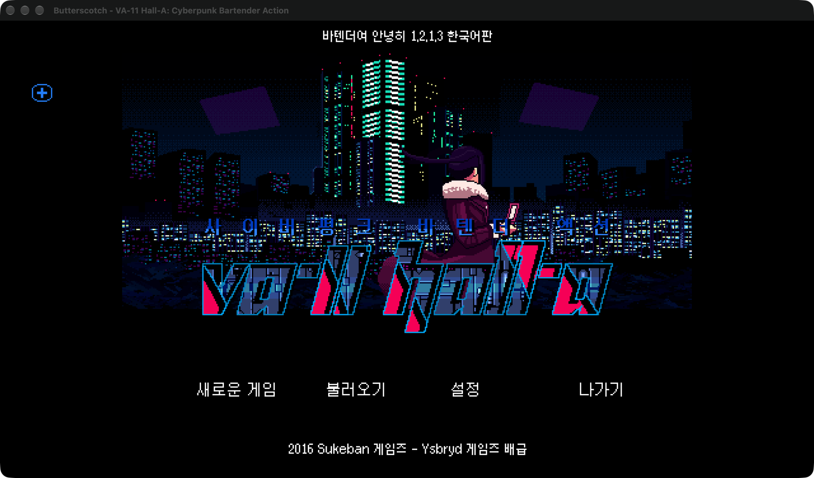

<p align="center">
  
</p>

<h1 align="center">VA-11 Hall-A for Mac</h1>

<p align="center">
  
  
  
</p>

> 한국어로 플레이하려면 **[한국어 패치](https://team-sm.tistory.com/96)**를 받아 주세요.

Play **VA-11 Hall-A: Cyberpunk Bartender Action** on current Macs, including Apple Silicon. Steam's Mac build is
32-bit, so Play does nothing on macOS 10.15 and later: this app runs the game natively with your own Steam copy.

## Install

Install the game in Steam, then paste this in Terminal and press `Return`:

```sh
curl -fsSL https://github.com/kecan0406/va11-hall-a-mac/releases/latest/download/install.sh | bash
```

When it says "All set", press **Play** in Steam. Saves live in `~/Library/Application Support/VA-11 Hall-A/`. If Play
stops working after Steam verifies or updates the game, run the line again.

A fan translation is asked about at the end of the install: drag the pack into the window, or drop it on
"VA-11 Hall-A Install Translation" in `~/Applications` ([docs/MODS.md](docs/MODS.md)).

Add after `bash -s --`:

| Option | What it does |
|---|---|
| `--remove-pack` | go back to the game's original text |
| `--uninstall` | remove the app and the Play button connection (saves are kept) |
| `--doctor` | show what the installer sees on this Mac |

## License

[AGPL-3.0](LICENSE) — derived from [Butterscotch](https://github.com/ButterscotchRunner/Butterscotch), which is also
AGPL-3.0. VA-11 Hall-A is by Sukeban Games, published by Ysbryd Games; this project isn't affiliated with them and
contains none of their work.
